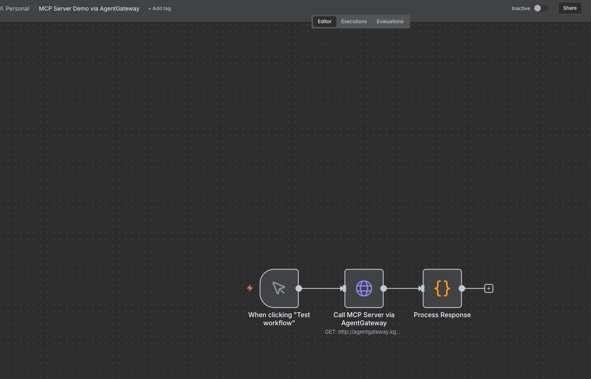
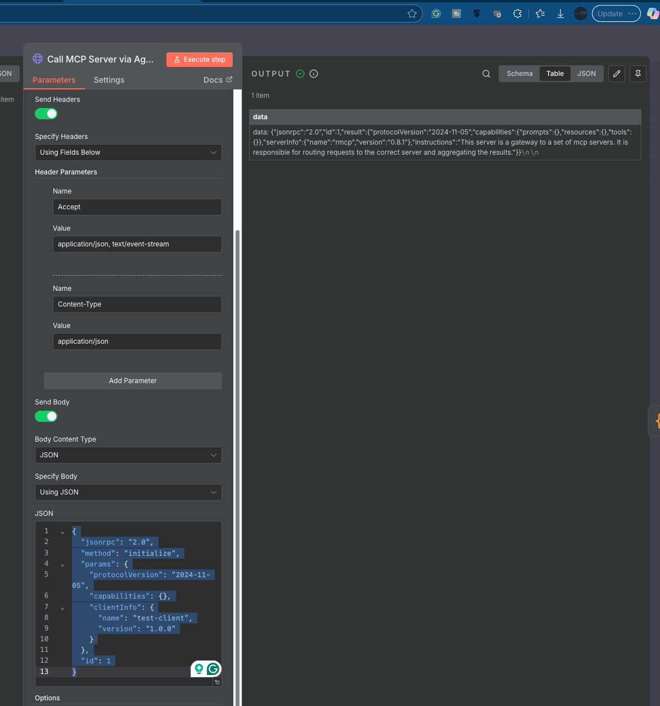

# n8n to MCP Server via agentgateway Demo

This demo shows how to connect [n8n](https://n8n.io/) to an MCP (Model Context Protocol) Server through [agentgateway](https://agentgateway.dev/) running as a dataplane in Kubernetes with [kgateway](https://kgateway.dev/) as the control plane.

## Architecture

```
n8n → agentgateway (K8s dataplane) → MCP Server (website-fetcher)
         ↑
    kgateway (control plane)
```

## Components

- **n8n**: Workflow automation platform for orchestrating API calls
- **kgateway**: Kubernetes-native control plane for API gateway management
- **agentgateway**: Dataplane that proxies requests to AI agents and MCP servers
- **MCP Server**: Website fetcher MCP server that can fetch and process web content

## Prerequisites

- Kubernetes cluster (minikube, kind, or cloud provider)
- kubectl configured
- Helm 3.x

## Quickstart

### Install

1. Run the configuration in `k8s/agentgateway/install.md`

2. Run the configuration in `k8s/mcp-server/mcp-server.md`

3. Run the configuration in `k8s/n8n/n8n-deployment.yaml`

### Access n8n UI

```
kubectl port-forward -n n8n svc/n8n 5678:5678
```

Open http://localhost:5678
- Username: `admin`
- Password: `admin`

## Import and Run n8n Workflow (1 minute)

### Setup

1. In n8n UI, click the orange **Create Workflow** button
2. On the top right, you'll see the icon for 3 dots.
3. Click the 3 docs and choose the **Import from File...** option
4. Upload the `mcp-demo-workflow.json` file thats uner the **n8n** directory
5. Click the **Call MCP Server via agentgateway**, which you'll configure in the next section



### Configuration

The following should be set:
- Method: `POST`
- URL: The URL of your gateway IP and the listener port, which is `8080`. For example: `http://135.23.125.225:8080/`
- Authentication: None
- Click the **Send Headers** button and add in the following two headers:
  1. Name: Accept
  2. Value: application/json, text/event-stream

  1. Name: Content-Type
  2. Value: application/json
- Click the **Send Body** button and add in the following JSON:
```
{
  "jsonrpc": "2.0",
  "method": "initialize",
  "params": {
    "protocolVersion": "2024-11-05",
    "capabilities": {},
    "clientInfo": {
      "name": "test-client",
      "version": "1.0.0"
    }
  },
  "id": 1
}
```

You should see an output similar to the below


## Directory Structure

```
.
├── README.md
├── k8s/
│   ├── agentgateway/      # agentgateway installation instructions
│   │   └── install.md     # Helm installation commands
│   ├── mcp-server/        # MCP server deployment
│   │   └── mcp-server.md # Complete MCP setup (deployment, service, gateway, backend, route)
│   └── n8n/              # n8n deployment
│       └── n8n-deployment.yaml
└── n8n/
    └── workflows/         # Sample n8n workflows
        └── mcp-demo-workflow.json
```

## How It Works

The demo uses the Kubernetes Gateway API pattern:

1. **Gateway** resource defines the entry point (listener on port 8080)
2. **HTTPRoute** connects the Gateway to the Backend and defines routing rules
3. **Backend** (custom kgateway resource) specifies the MCP server target with SSE protocol
4. **n8n** sends HTTP requests to the agentgateway service
5. **agentgateway** (dataplane) receives requests and routes them based on HTTPRoute configuration
6. **kgateway** (control plane) manages and configures the routing infrastructure
7. **MCP Server** (website-fetcher) processes the request and returns the response
8. Response flows back through agentgateway to n8n

**Resource Relationships:**
```
Gateway (agentgateway)
   ↓ parentRef
HTTPRoute (mcp-route)
   ↓ backendRef
Backend (mcp-backend)
   ↓ target
Service (mcp-website-fetcher)
```